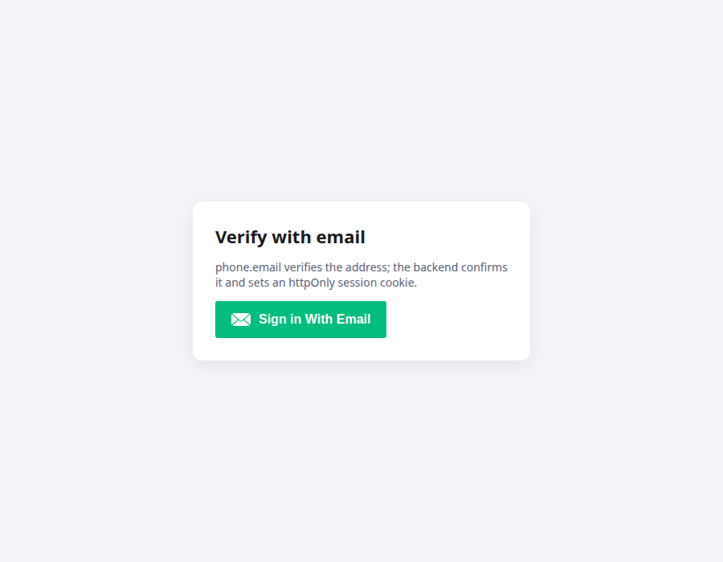

# Semi-Functional Email Auth

[](https://github.com/axe-hat/semi-functional-email-auth/actions/workflows/ci.yml)


A **"Verify with email"** button for React, built on [phone.email](https://www.phone.email/), plus a
small **Express backend** that confirms the verification and signs the user in with a secure
**httpOnly session cookie**. No passwords, and no tokens stored in the browser.



## How it works

```mermaid
sequenceDiagram
    participant U as User
    participant B as Browser (EmailVerificationButton)
    participant P as phone.email
    participant S as Your server (server/)
    U->>B: Click "Sign in With Email"
    B->>P: phone.email widget sends a one-time code to the user's inbox
    U->>P: Enters the code
    P-->>B: phoneEmailReceiver({ user_json_url, user_email_id })
    B->>S: POST /create-token { user_json_url }
    S->>S: Accept only https://user.phone.email/user_<id>.json
    S->>P: GET user_json_url
    P-->>S: { user_email_id: "jane@example.com" }
    S-->>B: Set-Cookie: session=<JWT>; HttpOnly; SameSite=Lax  +  { email, expiresIn }
    B->>S: GET /me (cookie sent automatically)
    S-->>B: { email, expiresAt }
```

The browser only forwards the `user_json_url` it received. **The server reads the verified email from
phone.email itself**, so a user can't sign in as someone else by editing the request.

## What's in the repo

| Folder                    | What it is                                                                                    |
| ------------------------- | --------------------------------------------------------------------------------------------- |
| `src/`                    | The React library: `EmailVerificationButton`, validation helpers, `RateLimiter`, typed errors |
| `server/`                 | Express + TypeScript backend: `/create-token`, `/me`, `/logout`, `/health`                    |
| `demo/`                   | Vite + React demo app using the library and the backend                                       |
| `tests/`, `server/tests/` | Jest tests for the library (incl. React Testing Library) and the backend (Supertest)          |

## Quick start (demo)

Requirements: Node.js 18+ and a free phone.email client ID (from the phone.email admin dashboard).

```bash
npm install                     # library (needed by the demo)
npm --prefix server install
npm --prefix demo install

cp server/.env.example server/.env
cp demo/.env.example demo/.env  # then set VITE_PHONE_EMAIL_CLIENT_ID

npm run dev:server              # http://localhost:4000
npm run dev:demo                # http://localhost:5173
```

The demo proxies `/create-token`, `/me` and `/logout` to the backend, so the session cookie is
same-origin and works without extra CORS setup. If port 4000 is taken, set `PORT` in
`server/.env` and start the demo with `API_URL=http://localhost:<port> npm run dev:demo`.

## Using the component

```tsx
import { EmailVerificationButton } from "semi-functional-email-auth";

<EmailVerificationButton
  clientId="YOUR_PHONE_EMAIL_CLIENT_ID"
  apiUrl="https://api.example.com" // omit if the backend is on the same origin
  onVerified={({ email }) => console.log("Signed in as", email)}
  onError={(error) => console.warn(error.name, error.message)}
/>;
```

If the backend is on a different origin, it must allow that origin with credentials (`CORS_ORIGIN`)
and serve over HTTPS (`COOKIE_SECURE=true`).

### Props

| Prop         | Type                                                            | Default            | Description                                      |
| ------------ | --------------------------------------------------------------- | ------------------ | ------------------------------------------------ |
| `clientId`   | `string`                                                        | — (required)       | Your phone.email client ID                       |
| `apiUrl`     | `string`                                                        | `""` (same origin) | Base URL of the backend                          |
| `onVerified` | `(user: { email; expiresIn }) => void`                          | —                  | Called after the backend sets the session cookie |
| `onError`    | `(error: AuthError \| ValidationError \| NetworkError) => void` | —                  | Called with a typed error                        |
| `className`  | `string`                                                        | —                  | Class for the wrapper element                    |
| `scriptSrc`  | `string`                                                        | phone.email script | Override the widget script URL (tests)           |

The component loads the phone.email script once per page, works with React StrictMode and several
buttons on one page, shows an error if the script can't load, announces progress to screen readers,
and limits repeated attempts in the browser (5 per minute).

## Backend

### Endpoints

| Method | Path            | Description                                                                                                    |
| ------ | --------------- | -------------------------------------------------------------------------------------------------------------- |
| `POST` | `/create-token` | Body `{ user_json_url }`. Confirms with phone.email, sets the `session` cookie, returns `{ email, expiresIn }` |
| `GET`  | `/me`           | Returns `{ email, expiresAt }` for a valid session, otherwise `401`                                            |
| `POST` | `/logout`       | Clears the session cookie (`204`)                                                                              |
| `GET`  | `/health`       | `{ status: "ok" }`                                                                                             |

### Configuration (`server/.env`)

| Variable              | Default                   | Description                                                            |
| --------------------- | ------------------------- | ---------------------------------------------------------------------- |
| `PORT`                | `4000`                    | Port to listen on                                                      |
| `JWT_SECRET`          | random per run (dev only) | **Required in production**, 32+ characters (`openssl rand -hex 32`)    |
| `SESSION_TTL_SECONDS` | `3600`                    | Session length                                                         |
| `CORS_ORIGIN`         | `http://localhost:5173`   | Comma-separated front-end origins allowed to call the API with cookies |
| `COOKIE_SECURE`       | `true` in production      | Send the cookie over HTTPS only                                        |

### Security measures

- **Verified on the server:** the email comes from phone.email's JSON, never from the browser.
- **Strict URL allow-list:** only `https://user.phone.email/user_<id>.json` (no other host, port,
  credentials, query or redirects), so the endpoint can't be abused to fetch other URLs.
- **httpOnly, SameSite=Lax cookie:** page scripts can't read the session (unlike `localStorage`).
- **Rate limiting:** 10 verification attempts per minute per IP, in addition to the browser limit.
- **Fails closed:** refuses to start in production without a strong `JWT_SECRET`; error responses
  never include stack traces.

## Utilities

```ts
import {
  validateEmail,
  validatePasswordStrength,
  sanitizeInput,
  RateLimiter,
  handleApiError,
} from "semi-functional-email-auth";

validateEmail("user@example.com"); // { isValid: true }
validateEmail("us..er@example.com"); // { isValid: false, error: "Invalid email format" }

validatePasswordStrength("Str0ng!Pass"); // { strength: "strong", score: 5, ... } (optional helper)

sanitizeInput("<b>hi</b>"); // "&lt;b&gt;hi&lt;&#x2F;b&gt;" (for raw HTML; React already escapes text)

const limiter = new RateLimiter({ maxRequests: 3, windowMs: 60_000 });
limiter.recordRequest(); // true until the limit is reached
```

## Development

```bash
npm run check        # lint + typecheck + tests + build (library)
npm run test:all     # library and backend tests
npm run format       # Prettier
npm --prefix server run build && npm --prefix server start   # production build of the backend
```

CI (GitHub Actions) runs lint, formatting, type checks, tests with coverage and builds for the
library, the backend and the demo on every push and pull request.

## Project structure

```
├── src/
│   ├── components/
│   │   ├── EmailVerificationButton.tsx
│   │   └── phoneEmailScript.ts        # loads the widget once, routes the callback
│   ├── types/index.ts
│   ├── utils/
│   │   ├── errorHandler.ts
│   │   ├── rateLimiter.ts
│   │   └── validation.ts
│   └── index.ts
├── tests/                             # library tests
├── server/
│   ├── src/  (app.ts, config.ts, phoneEmail.ts, index.ts)
│   └── tests/app.test.ts
├── demo/                              # Vite demo app
└── .github/workflows/ci.yml
```

## License

[MIT](LICENSE) © Akshat Kumar Jha
