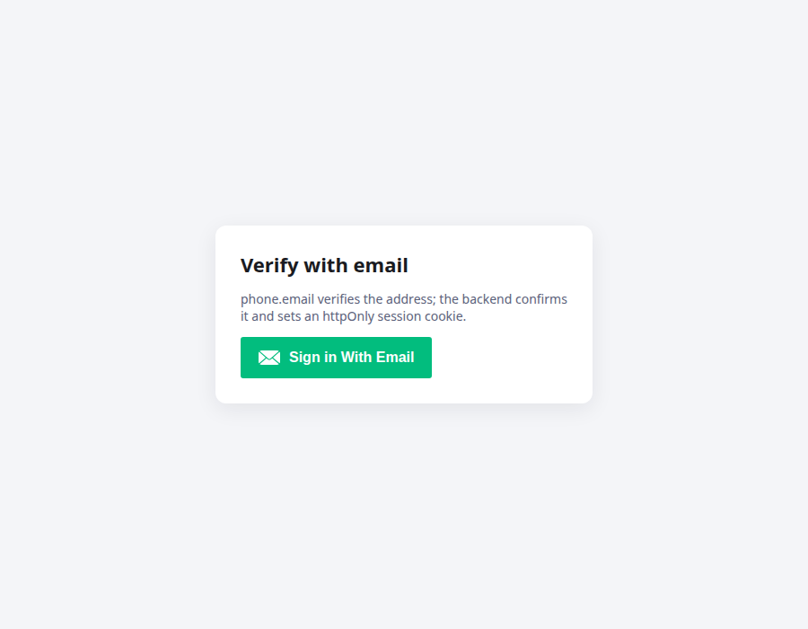

# Semi-Functional Email Auth

[](https://github.com/axe-hat/semi-functional-email-auth/actions/workflows/ci.yml)
[](https://github.com/axe-hat/semi-functional-email-auth/actions/workflows/codeql.yml)
[](https://scorecard.dev/viewer/?uri=github.com/axe-hat/semi-functional-email-auth)


A **"Verify with email"** button for React, built on [phone.email](https://www.phone.email/), plus a
small **Express backend** that confirms the verification and signs the user in with a secure
**httpOnly session cookie**. After the first sign-in, users can add a **passkey** and skip the email
step next time. No passwords, and no tokens stored in the browser.



- **Drop-in or headless:** use `<EmailVerificationButton>`, or the `useEmailVerification` and
  `useSession` hooks with your own UI.
- **Secure by default:** single-use verifications, CSRF and login-CSRF protection, server-side
  logout, `__Host-` cookies and strict security headers. See the [threat model](docs/security-design.md).
- **Passkeys (optional):** WebAuthn sign-in via [SimpleWebAuthn](https://simplewebauthn.dev), in a
  separate entry point so it costs nothing if you don't use it.
- **Tested end to end:** unit tests, an OpenAPI spec checked against the real routes, Playwright
  tests in Chromium, Firefox and WebKit (dev server and the production Docker images), a real
  passkey ceremony with a virtual authenticator, and the packed package built into a fresh app.

## How it works

```mermaid
sequenceDiagram
    participant U as User
    participant B as Browser (EmailVerificationButton)
    participant P as phone.email
    participant S as Your server (server/)
    U->>B: Click "Sign in With Email"
    B->>P: phone.email widget sends a one-time code to the user's inbox
    U->>P: Enters the code
    P-->>B: phoneEmailReceiver({ user_json_url, user_email_id })
    B->>S: POST /create-token { user_json_url }
    S->>S: Allow only https://user.phone.email/user_<id>.json, and only once
    S->>P: GET user_json_url
    P-->>S: { user_email_id: "jane@example.com" }
    S-->>B: Set-Cookie: __Host-session=<JWT>; HttpOnly; Secure; SameSite=Strict
    B->>S: GET /me (cookie sent automatically)
    S-->>B: { email, expiresAt }
```

The browser only forwards the `user_json_url` it received. **The server reads the verified email from
phone.email itself**, so a user can't sign in as someone else by editing the request, and each
verification URL works only once.

## What's in the repo

| Folder                    | What it is                                                                                 |
| ------------------------- | ------------------------------------------------------------------------------------------ |
| `src/`                    | The React library: button, hooks, passkeys entry point, validation helpers, typed errors   |
| `server/`                 | Express + TypeScript backend, with an [OpenAPI spec](server/openapi.json) and a Dockerfile |
| `demo/`                   | Vite + React demo app using the library and the backend                                    |
| `e2e/`                    | Playwright tests (phone.email stubbed) and a fresh app that installs the packed package    |
| `tests/`, `server/tests/` | Jest tests for the library (React Testing Library) and the backend (Supertest)             |
| `docs/`                   | [Security design / threat model](docs/security-design.md)                                  |

## Quick start (demo)

You need a free phone.email client ID from the phone.email admin dashboard. While you're there,
turn on **domain whitelisting** for your sites.

**With Docker** (one command, http://localhost:8080):

```bash
JWT_SECRET=$(openssl rand -hex 32) VITE_PHONE_EMAIL_CLIENT_ID=<your id> docker compose up --build
```

The demo image is nginx serving the built app and proxying the API to `API_UPSTREAM` (default
`http://server:4000`), so you can also run it in front of a backend hosted elsewhere.

**With Node.js 22.11+** (22, 24 or 26):

```bash
npm install                     # library (needed by the demo)
npm --prefix server install
npm --prefix demo install

cp server/.env.example server/.env
cp demo/.env.example demo/.env  # then set VITE_PHONE_EMAIL_CLIENT_ID

npm run dev:server              # http://localhost:4000
npm run dev:demo                # http://localhost:5173
```

The demo proxies the API (`/create-token`, `/me`, `/logout`, `/passkeys`) to the backend, so the
session cookie is same-origin. If port 4000 is taken, set `PORT` in `server/.env` and start the demo
with `API_URL=http://localhost:<port> npm run dev:demo`.

## Using the library

### The button

```tsx
import { EmailVerificationButton } from "semi-functional-email-auth";

<EmailVerificationButton
  clientId="YOUR_PHONE_EMAIL_CLIENT_ID"
  apiUrl="https://api.example.com" // omit if the backend is on the same origin
  onVerified={({ email }) => console.log("Signed in as", email)}
  onError={(error) => console.warn(error.name, error.message)}
/>;
```

| Prop         | Type                                                            | Default            | Description                                         |
| ------------ | --------------------------------------------------------------- | ------------------ | --------------------------------------------------- |
| `clientId`   | `string`                                                        | — (required)       | Your phone.email client ID                          |
| `apiUrl`     | `string`                                                        | `""` (same origin) | Base URL of the backend                             |
| `onVerified` | `(user: { email; expiresIn }) => void`                          | —                  | Called after the backend sets the session cookie    |
| `onError`    | `(error: AuthError \| ValidationError \| NetworkError) => void` | —                  | Called with a typed error                           |
| `labels`     | `{ verifying?: string; verified?: (email) => string }`          | English            | Your own text (e.g. another language)               |
| `className`  | `string`                                                        | —                  | Class for the wrapper element                       |
| `classNames` | `{ status?; success?; error?; widget? }`                        | —                  | Classes for each part                               |
| `unstyled`   | `boolean`                                                       | `false`            | Drop the built-in inline styles; style with classes |
| `scriptSrc`  | `string`                                                        | phone.email script | Override the widget script URL (tests)              |

The component loads the phone.email script once, redraws the widget when the button mounts again
(e.g. after sign-out), handles React StrictMode, shows an error if the script can't load, announces
progress to screen readers, and limits repeated attempts in the browser (5 per minute).
phone.email's widget draws into the first `.pe_verify_email` element on the page, so use **one
button per page**.

### Hooks

```tsx
import { useEmailVerification, useSession } from "semi-functional-email-auth";

function Account() {
  const { status, session, refresh, logout } = useSession(); // reads GET /me
  if (status === "loading") return <p>Loading…</p>;
  if (session) return <button onClick={logout}>Sign out {session.email}</button>;
  return <SignIn onDone={refresh} />;
}

function SignIn({ onDone }: { onDone: () => void }) {
  const { state } = useEmailVerification({ onVerified: onDone });
  return (
    <>
      {state.error && <p role="alert">{state.error}</p>}
      <div className="pe_verify_email" data-client-id="YOUR_CLIENT_ID" />
    </>
  );
}
```

- `useSession({ apiUrl? })` → `{ status: "loading" | "authenticated" | "unauthenticated", session, error, refresh, logout }`.
  `logout()` revokes the session on the server.
- `useEmailVerification({ apiUrl?, onVerified?, onError?, scriptSrc? })` → `{ state, reset }`. You
  render the `.pe_verify_email` element yourself.

### Passkeys

Install the optional peer dependency: `npm install @simplewebauthn/browser`.

```tsx
import { usePasskeys } from "semi-functional-email-auth/passkeys";

const { supported, register, signIn, isWorking, error } = usePasskeys();

// Signed in (after email verification): add a passkey to the account.
await register(); // true on success

// Signed out: sign in with a passkey instead of email.
const user = await signIn(); // { email, expiresIn } or null (cancelled / failed, see `error`)
```

The backend needs to know where passkeys are used: `WEBAUTHN_RP_ID` (your domain) and
`WEBAUTHN_ORIGINS` default to the first `CORS_ORIGIN`.

## Backend

### Endpoints

Full details are in [`server/openapi.json`](server/openapi.json) (OpenAPI 3.1; open it in
[Swagger Editor](https://editor.swagger.io) or any OpenAPI viewer).

| Method   | Path                         | Description                                                                         |
| -------- | ---------------------------- | ----------------------------------------------------------------------------------- |
| `POST`   | `/create-token`              | Body `{ user_json_url }`. Confirms with phone.email (once per URL), sets the cookie |
| `GET`    | `/me`                        | `{ email, expiresAt }` for a valid session, otherwise `401`                         |
| `POST`   | `/logout`                    | Revokes the session and clears the cookie (`204`)                                   |
| `GET`    | `/passkeys`                  | The signed-in user's passkeys                                                       |
| `POST`   | `/passkeys/register/options` | Start adding a passkey (signed in)                                                  |
| `POST`   | `/passkeys/register/verify`  | Finish adding a passkey                                                             |
| `POST`   | `/passkeys/login/options`    | Start passkey sign-in                                                               |
| `POST`   | `/passkeys/login/verify`     | Finish passkey sign-in, sets the cookie                                             |
| `DELETE` | `/passkeys/:id`              | Delete one of your passkeys                                                         |
| `GET`    | `/health`                    | `{ status: "ok" }`                                                                  |

### Configuration (`server/.env`)

| Variable                | Default                   | Description                                                                        |
| ----------------------- | ------------------------- | ---------------------------------------------------------------------------------- |
| `PORT`                  | `4000`                    | Port to listen on                                                                  |
| `JWT_SECRET`            | random per run (dev only) | **Required in production**, 32+ characters (`openssl rand -hex 32`)                |
| `SESSION_TTL_SECONDS`   | `3600`                    | Session length                                                                     |
| `RATE_LIMIT_PER_MINUTE` | `10`                      | Sign-in attempts per IP per minute (email and passkey)                             |
| `CORS_ORIGIN`           | `http://localhost:5173`   | Comma-separated front-end origins allowed to call the API (CORS and CSRF check)    |
| `COOKIE_SECURE`         | `true` in production      | HTTPS-only cookie, named `__Host-session`                                          |
| `COOKIE_SAME_SITE`      | `strict`                  | `strict`, `lax`, or `none` (front end on another site; needs `COOKIE_SECURE=true`) |
| `WEBAUTHN_RP_ID`        | host of first origin      | Domain passkeys belong to, e.g. `example.com`                                      |
| `WEBAUTHN_RP_NAME`      | `Email Auth`              | Name shown in the passkey prompt                                                   |
| `WEBAUTHN_ORIGINS`      | `CORS_ORIGIN`             | Origins allowed to use passkeys                                                    |

Running more than one instance, or need passkeys to survive restarts? Pass shared stores:
`createApp({ config, stores: { usedUrls, revokedSessions, challenges, passkeys } })`. The
interfaces are in `server/src/store.ts` and `server/src/passkeyStore.ts`.

### Security measures

- **Verified on the server:** the email comes from phone.email's JSON, never from the browser.
- **Strict URL allow-list** (no SSRF), and **each verification URL works once** (no replay).
- **httpOnly `__Host-` cookie, `SameSite=Strict`**, plus an **Origin / Fetch Metadata check** on every
  state-changing request (CSRF and login CSRF).
- **Real logout:** sessions are revoked server-side, so a copied cookie stops working.
- **Passkeys** with single-use challenges, origin/RP checks and required user verification.
- **Rate limits**, `helmet` security headers, `Cache-Control: no-store`, generic error messages, and
  no start-up in production without a strong `JWT_SECRET`.

Threats, mitigations, the tests that cover them, and known limits: [docs/security-design.md](docs/security-design.md).
To report a vulnerability, see [SECURITY.md](SECURITY.md).

## Utilities

```ts
import {
  validateEmail,
  validatePasswordStrength,
  sanitizeInput,
  RateLimiter,
  handleApiError,
} from "semi-functional-email-auth";

validateEmail("user@example.com"); // { isValid: true }
validateEmail("us..er@example.com"); // { isValid: false, error: "Invalid email format" }

validatePasswordStrength("Str0ng!Pass"); // { strength: "strong", score: 5, ... } (optional helper)

sanitizeInput("<b>hi</b>"); // "&lt;b&gt;hi&lt;&#x2F;b&gt;" (for raw HTML; React already escapes text)

const limiter = new RateLimiter({ maxRequests: 3, windowMs: 60_000 });
limiter.recordRequest(); // true until the limit is reached
```

## Development

```bash
npm run check          # lint + typecheck + tests + build + package checks (publint, attw)
npm run test:all       # library and backend tests
npm run test:e2e       # Playwright (first: npm --prefix e2e install && npm --prefix e2e run install-browser)
E2E_BROWSERS=chromium,firefox,webkit npm run test:e2e   # all three browsers (default: chromium)
npm --prefix e2e run test:docker   # the same tests against the Docker images (nginx + server)
npm run format         # Prettier
npm --prefix server run build && npm --prefix server start   # production build of the backend
```

CI (GitHub Actions) runs on every push and pull request:

- the library and the backend on Node 22, 24 and 26, and the library on React 19;
- the packed package, installed and built in a fresh app (ESM imports and `require()`);
- the backend with a coverage gate;
- end-to-end tests in Chromium, Firefox and WebKit, and again against the Docker images;
- CodeQL and OpenSSF Scorecard.

Dependabot keeps dependencies and Actions (pinned by commit SHA) up to date.

### Releasing

Changes to the published library get a changeset (`npm run changeset`). The Release workflow turns
them into a version PR and, once merged, publishes to npm **with provenance** through trusted
publishing (no npm token stored). Setup steps are at the top of `.github/workflows/release.yml`.

See [CONTRIBUTING.md](CONTRIBUTING.md) for more.

## Project structure

```
├── src/
│   ├── components/   EmailVerificationButton.tsx, phoneEmailScript.ts (widget loader)
│   ├── hooks/        useEmailVerification.ts, useSession.ts
│   ├── passkeys/     usePasskeys.ts  (entry point: semi-functional-email-auth/passkeys)
│   ├── types/, utils/
│   └── index.ts
├── tests/                        library tests
├── server/
│   ├── src/   app.ts, config.ts, phoneEmail.ts, session.ts, security.ts, store.ts,
│   │          passkeys.ts, passkeyStore.ts, index.ts
│   ├── tests/ app, passkeys, store and OpenAPI tests
│   ├── openapi.json, Dockerfile
├── demo/                         Vite demo app (+ Dockerfile, nginx.conf.template)
├── e2e/                          Playwright tests, Docker test setup, consumer/ package check
├── docs/security-design.md
├── docker-compose.yml
└── .github/                      CI, CodeQL, Scorecard, Release, Dependabot, templates
```

## License

[MIT](LICENSE) © Akshat Kumar Jha
