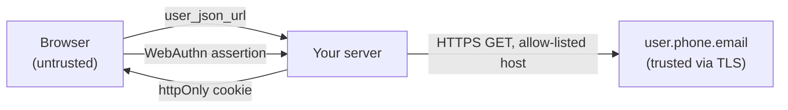

# Security design

How the sign-in flow is protected, what each protection is for, where it's tested, and what it
deliberately doesn't cover.

## What is protected

- **The session**: whoever holds a valid session cookie is treated as the owner of that email.
- **The email claim**: a user must not be able to sign in as an address they didn't verify.
- **Passkeys**: a registered passkey signs in to exactly one account.

## Trust boundaries

Everything the browser sends is untrusted. The server trusts only what it fetches itself from
`https://user.phone.email` over TLS, and signatures it checks itself.

## Threats and mitigations

| Threat                                                                        | Mitigation                                                                                                                                                                                                       | Tested in                                                    |
| ----------------------------------------------------------------------------- | ---------------------------------------------------------------------------------------------------------------------------------------------------------------------------------------------------------------- | ------------------------------------------------------------ |
| Client claims someone else's email                                            | The browser sends only `user_json_url`; the server fetches it and reads `user_email_id` itself. Any email in the request body is ignored.                                                                        | `server/tests/app.test.ts`                                   |
| `user_json_url` abused to make the server fetch other URLs (SSRF)             | Strict allow-list: `https:`, host exactly `user.phone.email`, path `/user_<id>.json`, no port, credentials, query or fragment; redirects refused; 5 s timeout.                                                   | `app.test.ts` (12 malicious URL shapes)                      |
| A leaked or copied `user_json_url` (logs, history, proxy) is reused           | Each URL signs in **once**: its SHA-256 is claimed atomically before fetching and kept for 7 days. Parallel requests can't both win. If phone.email is unreachable, the claim is released so the user can retry. | `app.test.ts` "replay protection", e2e                       |
| Session theft by XSS                                                          | Session is an **httpOnly** cookie; no token is ever in `localStorage` or readable by scripts.                                                                                                                    | `app.test.ts`, e2e (checks `document.cookie`)                |
| Cookie overwritten from a sibling subdomain (cookie tossing)                  | Over HTTPS the cookie is named `__Host-session`: Secure, `Path=/`, no `Domain`.                                                                                                                                  | `app.test.ts`                                                |
| CSRF, including **login CSRF** (signing a victim into the attacker's account) | `SameSite=Strict` by default; every non-GET request must carry an allowed `Origin` (or no `Sec-Fetch-Site: cross-site`); `/create-token` accepts only `application/json`, which forces a CORS preflight.         | `app.test.ts` "CSRF defences", passkey tests, e2e            |
| Stolen cookie keeps working after logout                                      | Each session has a random ID (`jti`); logout revokes it server-side until the token's own expiry. Logout also sends `Clear-Site-Data: "cookies"`.                                                                | `app.test.ts` "logout revokes the token"                     |
| Forged or algorithm-confused tokens                                           | HS256 only, with a 32+ character secret that is **required** in production; tokens without a session ID are rejected.                                                                                            | `app.test.ts`                                                |
| Brute force and abuse                                                         | 10 attempts per minute per IP (`RATE_LIMIT_PER_MINUTE`) on `/create-token` and passkey sign-in; 5 per minute in the browser; 10 kB body limit.                                                                   | `app.test.ts`                                                |
| Passkey replay or phishing                                                    | Challenges are random, single-use and expire after 5 minutes; origin and RP ID are checked; user verification is required; the signature counter is updated to spot cloned authenticators.                       | `server/tests/passkeys.test.ts`, e2e (virtual authenticator) |
| Account enumeration through passkey sign-in                                   | Unknown and invalid passkeys get the same `401` message.                                                                                                                                                         | `passkeys.test.ts`                                           |
| Personal data cached by browsers or proxies                                   | `Cache-Control: no-store` on every auth response.                                                                                                                                                                | `app.test.ts`                                                |
| Clickjacking, MIME sniffing, missing HTTPS                                    | `helmet`: `Content-Security-Policy: default-src 'none'; frame-ancestors 'none'`, `nosniff`, HSTS, and more.                                                                                                      | `app.test.ts`                                                |
| Information leaks in errors                                                   | Unknown errors return a generic 500; stack traces are only logged.                                                                                                                                               | `app.test.ts`                                                |

## Known limits

- **Single process by default.** Used URLs, revoked sessions, passkey challenges and passkeys are kept
  in memory. With more than one instance, or if passkeys must survive restarts, pass shared stores
  to `createApp({ stores })`: `TtlStore` (e.g. Redis `SET … PX … NX`) and `PasskeyStore` (your
  database).
- **phone.email's JSON isn't signed.** Trust rests on TLS to `user.phone.email` and the strict
  allow-list. phone.email doesn't document whether a `user_json_url` expires; the 7-day single-use
  window covers reuse on this server.
- **Turn on domain whitelisting** for your client ID in the phone.email dashboard, so the widget
  only works on your own sites.
- **Email verification proves inbox access, not identity.** For a strong sign-in, encourage users
  to add a passkey after their first email sign-in. Sessions are absolute (default 1 hour) with no
  idle timeout.
- **The front end's own CSP** is the host app's job. If you use one, allow
  `https://www.phone.email` in `script-src` and `https://auth.phone.email` in `connect-src`, and
  allow the popup.
- **The widget script** is third-party code that runs on your page. It can't be pinned with Subresource
  Integrity because phone.email doesn't publish versioned files.
